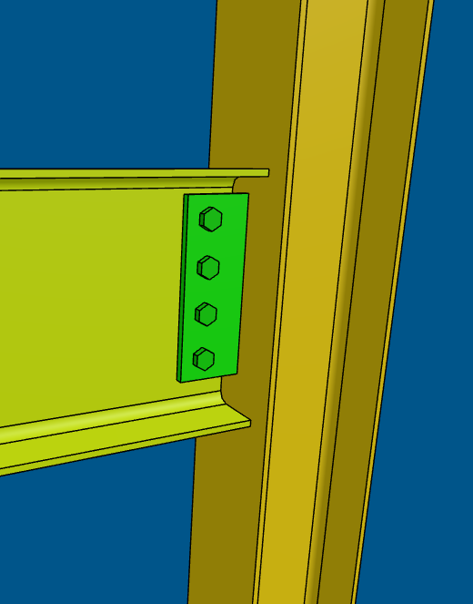
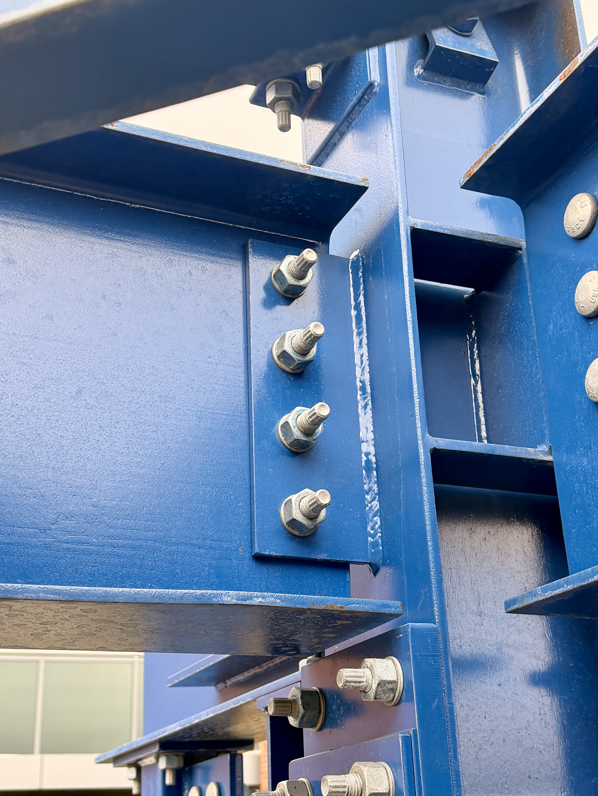

Commentary
==========

This 3D model shows a single plate shear connection, also known as a shear tab
connection.

A shear tab connection includes a plate that is typically shop-welded to the
girder or column and then field-bolted to the beam web. This is a very popular
connection type for floor framing.

Several limit states are illustrated with 3D models to help you visualize the
component involved. Browse the models and explore the additional commentary to
gain a deeper understanding of various limit states for this type of connection.
