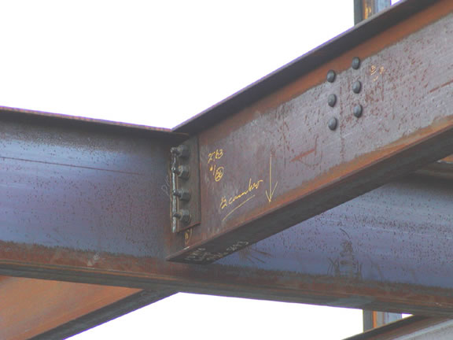
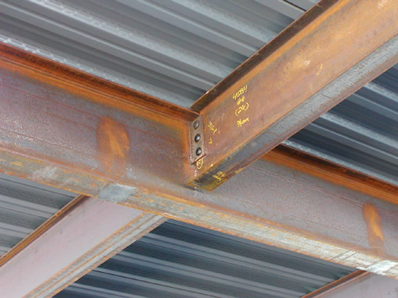

Sample Photos
=============

This connection appears on the AISC Steel Sculpture. 

Here are some sample photos of other shear tab connections. Shear tab
connections are commonly used for floor framing to connect beams to columns and
to connect beams to girders.

Beam to Girder
--------------

<figure>

<figcaption>Beam-to-girder connections</figcaption>
</figure>

Beam to Column
--------------

