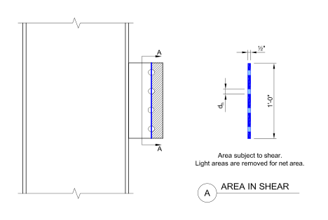

2D Graphics
===========

The limit states for shear yielding and shear rupture of the plate are
illustrated with the following 2D graphics.

The net shear area of the plate ($A_{nt}$) is equal to the gross area of the
plate minus the material removed for the bolt holes.

This connection uses 3/4 in. diameter bolts in short slots. The nominal hole
dimension for the short-slot is 13/16 in. × 1 in. (AISC *Manual* Table J3.3).

When computing the net area for shear or tension, the width of the bolt hole
should be taken as 1/16 in. larger than the nominal dimension of the hole (AISC
*Spec* B4.3b).
