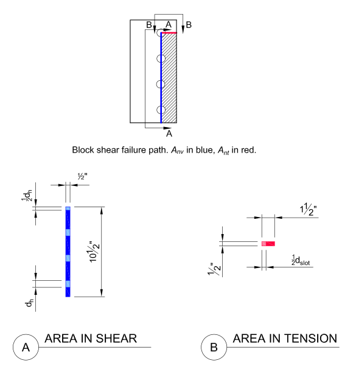

2D Graphics
===========

The limit state of block shear for the plate is illustrated with the following
2D graphics.

The gross area subject to shear ($A_{gv}$) is the gross area from the
centerline of the top bolt to the bottom side of the plate.

The net area subject to shear ($A_{nv}$) is the gross area subject to shear 
minus the material removed for three and a half bolt holes. Since this is a net 
area for shear, the width of the bolt hole should be taken as 1/16 in. larger 
than the nominal dimension of the hole (AISC *Spec* B4.3b).

The net area subject to tension ($A_{nt}$) is the gross area subject to tension 
minus the material removed for one half bolt hole. The bolt hole is a short 
slotted hole that is 1 in. wide in the horizontal direction. Since this is 
considering a net area for tension, the width of the bolt hole (slot) should be 
taken as 1/16 in. larger than the nominal dimension (AISC *Spec* B4.3b).
